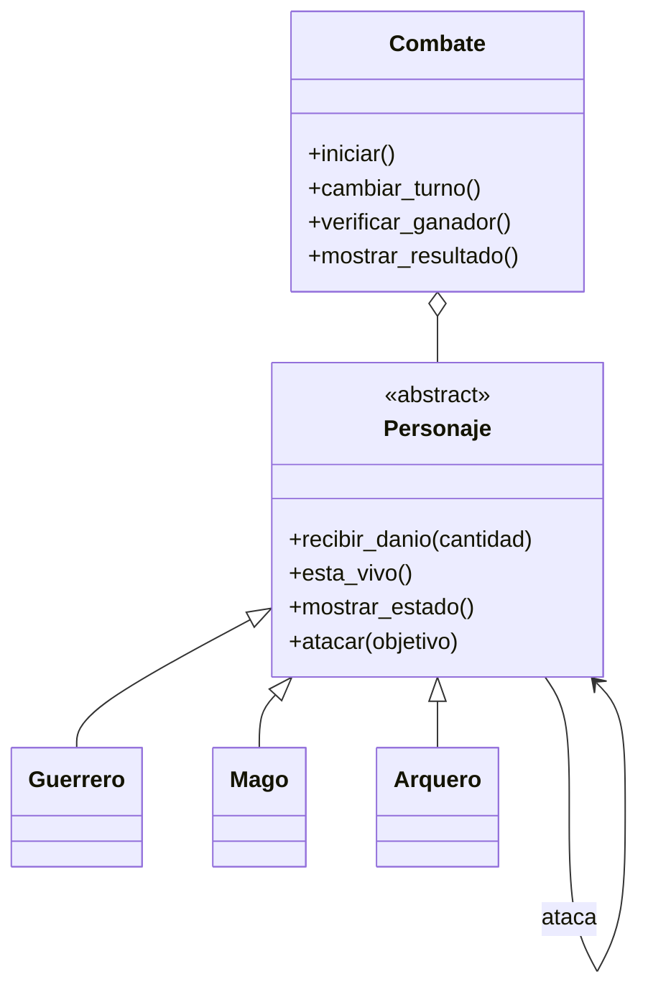

# Guardians of the Ancient Kingdom

## Descripción
Sistema de combate por turnos desarrollado en Python que enfrenta guerreros, magos y arqueros mediante reglas de ataque diferentes.

## Archivos
- `personajes.py`: contiene las clases y la lógica de combate.
- `main.py`: ejecuta el programa y las pruebas con Pytest.
- `README.md`: documenta el proyecto.

## Clases
- `Personaje`: clase abstracta con atributos y métodos comunes.
- `Guerrero`: incrementa su ataque un 20 % antes de descontar la defensa.
- `Mago`: ignora la defensa del objetivo.
- `Arquero`: duplica el daño si su ataque supera la defensa.
- `Combate`: controla los turnos y determina el resultado.

## Conceptos de POO
- **Abstracción:** `Personaje` define el comportamiento común y exige implementar `atacar()`.
- **Encapsulamiento:** las propiedades validan los atributos privados.
- **Herencia:** los tres tipos de guardianes heredan de `Personaje`.
- **Polimorfismo:** cada clase implementa `atacar()` de forma diferente.

## Relaciones
- Herencia entre `Personaje` y sus subclases.
- Asociación entre personajes cuando se atacan.
- Agregación porque `Combate` administra personajes creados independientemente.

## Diagrama UML



## Reto de abstracción
`atacar()` es abstracto porque cada clase calcula el daño de manera diferente. En cambio, `recibir_danio()` puede compartirse porque todos los personajes deben aplicar las mismas reglas para descontar vida y evitar valores negativos.

## Ejecución
Ejecutar la demostración:

```bash
python main.py
```

Instalar Pytest:

```bash
python -m pip install pytest
```

Ejecutar las pruebas:

```bash
python -m pytest main.py -v
```

## Pruebas
Las pruebas comprueban la creación de personajes, las validaciones, las habilidades especiales, la vida mínima, la abstracción y los resultados del combate.
